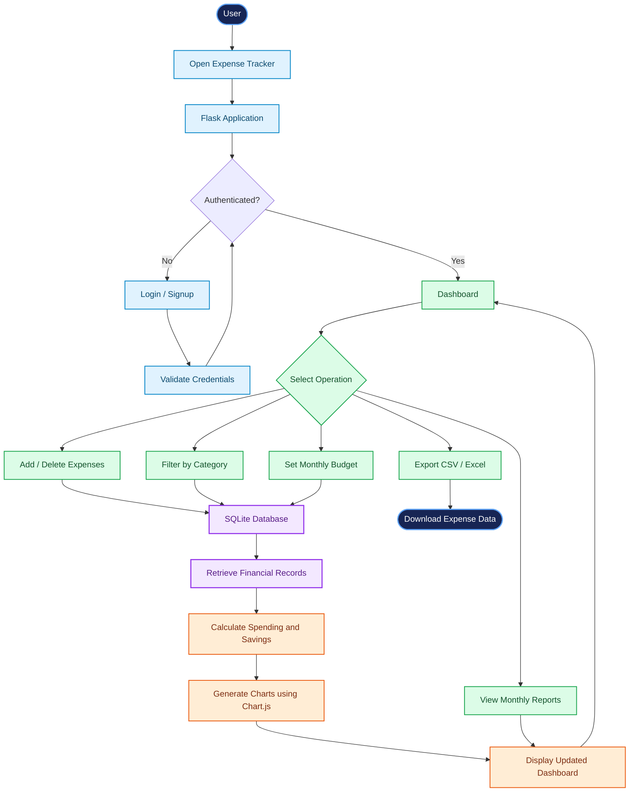

# Student Expense Tracker

### Track Your Expenses. Manage Your Budget. Build Better Saving Habits.

<p align="center">
  
  
  
  
  
</p>

## Overview

Managing personal expenses is an important aspect of financial planning. Students often face difficulties tracking their daily expenditures, which can lead to overspending and poor budgeting.

**Student Expense Tracker** is a Flask-based web application developed to help users record, categorize, analyze and manage their expenses efficiently.

The application uses SQLite for storing user and expense information and provides features such as expense management, category-wise filtering, monthly expenditure reports, budget tracking, savings estimation, data visualization and CSV/Excel export.

The primary goal is to provide students with a simple and accessible platform for monitoring their spending habits and improving financial awareness.

## Project Objectives

- Help students manage their daily expenses.
- Provide an easy-to-use budgeting tool.
- Maintain organized records of financial transactions.
- Generate monthly expenditure reports.
- Visualize spending patterns using charts.
- Monitor budget utilization and estimate savings.
- Improve financial awareness and encourage better spending habits.

## Features

### 1. User Authentication

- User registration and login.
- Password hashing for secure password storage.
- Session-based user authentication.
- Individual expense management.

### 2. Expense Management

Users can record their expenses with the following details:

- Amount
- Category
- Description
- Date

Available operations include:

- Add new expenses.
- View expense history.
- Delete existing expenses.
- Maintain organized expense records.

### 3. Category-wise Filtering

Expenses can be organized and filtered based on categories such as:

- Food
- Transport
- Shopping
- Hostel
- Entertainment

This helps users understand where most of their money is being spent.

### 4. Monthly Reports

The application provides monthly financial summaries, including:

- Total monthly expenditure.
- Highest-spending category.
- Estimated savings.

These summaries help users monitor their financial habits over time.

### 5. Budget Tracking

Users can set a monthly budget, and the application calculates the remaining amount based on recorded expenses.

This helps users monitor their spending against their planned budget.

### 6. Savings Estimation

The application estimates potential savings by considering the monthly budget and total expenditure.

### 7. Data Visualization

Charts are generated using Chart.js to present financial information visually.

The visualizations include:

- Category-wise spending distribution.
- Weekly spending trends.

### 8. Data Export

Users can export their expense records for external use and analysis.

Supported formats:

- CSV
- Excel

## Application Workflow

The following flowchart illustrates the overall working process of the application, from user authentication to expense management and financial reporting.



## Technology Stack

| Category | Technology |
|---|---|
| Programming Language | Python 3.x |
| Backend Framework | Flask |
| Database | SQLite |
| ORM | Flask-SQLAlchemy |
| Frontend | HTML |
| Styling | CSS |
| Client-side Functionality | JavaScript |
| Data Visualization | Chart.js |
| Data Processing | Pandas |
| Excel Support | OpenPyXL |
| Password Security | Werkzeug |
| Templating Engine | Jinja2 |

## Database Design

The application uses SQLite with Flask-SQLAlchemy for database management.

The database contains two primary models:

### User Model

Stores registered user information.

| Field | Description |
|---|---|
| `id` | Primary key |
| `username` | Unique username |
| `password` | Hashed password |

### Expense Model

Stores individual expense records.

| Field | Description |
|---|---|
| `id` | Primary key |
| `amount` | Expense amount |
| `category` | Expense category |
| `description` | Expense description |
| `date` | Date of transaction |
| `user_id` | Foreign key referencing the user |

Each expense record is associated with a user through the `user_id` foreign key.

## Repository Structure

```text
expense-tracker/
│
├── static/
│   └── CSS, JavaScript and static assets
│
├── templates/
│   └── HTML templates
│
├── app.py
├── expenses.db
├── expenses.xlsx
├── .gitignore
├── README.md
│
└── Student_Expense_Tracker_Documentation.pdf
```

`expenses.db` is the SQLite database configured by the application. It may be generated when the database tables are initialized.

`expenses.xlsx` is an accompanying Excel file included in the repository.

*The static and templates directories may contain additional files and subdirectories.*

## Installation and Setup

### 1. Clone the Repository

```bash
git clone https://github.com/ShadowCyberNinjaX/expense-tracker.git

cd expense-tracker
```

### 2. Create a Virtual Environment

```bash
python3 -m venv venv
```

Activate the environment:

**Linux / macOS**

```bash
source venv/bin/activate
```

**Windows**

```bash
venv\Scripts\activate
```

### 3. Install Dependencies

Install the required Python packages:

```bash
python -m pip install Flask Flask-SQLAlchemy pandas openpyxl
```

Werkzeug is installed as a dependency of Flask, while `datetime` is included in Python's standard library.

### 4. Initialize the Database

If your application initializes its tables using `DB.create_all()`, make sure that this initialization is executed within the Flask application context before using the database.

For example:

```python
with app.app_context():
    DB.create_all()
```

### 5. Run the Application

```bash
python app.py
```

Open the application in your browser:

```text
http://127.0.0.1:5000/
```

Register an account or log in to start managing expenses.

## Screenshots

The following screenshots demonstrate the application's interface.

### Login and Signup

Add screenshots of the authentication pages here.

```markdown


```

### Dashboard

The dashboard displays the monthly budget, total spending, estimated savings and highest-spending category, along with expense records.

```markdown

```

### Expense Management

The application allows users to add and delete expense records.

```markdown

```

### Reports and Visualization

Add screenshots of the monthly reports and charts here.

```markdown

```

## Results and Discussion

The developed application provides the essential functionalities required for personal expense management.

### Achieved Results

- Storage and retrieval of expense records using SQLite.
- User registration and login functionality.
- Expense addition and deletion.
- Category-based expense organization.
- Automatic calculation of monthly expenditure.
- Budget tracking and savings estimation.
- Visual representation of spending patterns.
- Export functionality for external analysis.

The application simplifies financial tracking for students and provides useful insights into spending behavior. Graphical representations help users understand how their money is distributed across different categories and time periods.

## Deployment Strategy

The project can be deployed using cloud hosting platforms such as:

- Render
- Railway
- PythonAnywhere

General deployment steps:

1. Upload the project to GitHub.
2. Connect the repository to a hosting platform.
3. Configure the Python environment.
4. Install the required dependencies.
5. Configure the database and environment variables.
6. Deploy and test the application.

## Future Improvements

- AI-based spending predictions.
- More detailed financial analytics.
- Mobile-responsive interface.
- Cloud database integration.
- Improved budget alerts and spending notifications.
- Additional visualization and reporting options.

## Learning Outcomes

This project demonstrates practical experience in:

- Web application development using Flask.
- Database management using SQLite and SQLAlchemy.
- Implementing CRUD operations.
- User authentication and password hashing.
- Backend and frontend integration.
- Data visualization using Chart.js.
- Financial data processing using Pandas.
- Exporting structured data into CSV and Excel formats.

## Author

**Priyasha Haldar**

B.Sc. Computer Science  
Visva-Bharati, Santiniketan

GitHub: [ShadowCyberNinjaX](https://github.com/ShadowCyberNinjaX)

---

**Project:** Student Expense Tracker  
**Category:** Web Development / Personal Finance Management  
**Academic Project:** Software Engineering, Semester IV  
**Academic Year:** 2025–2026nance Management
