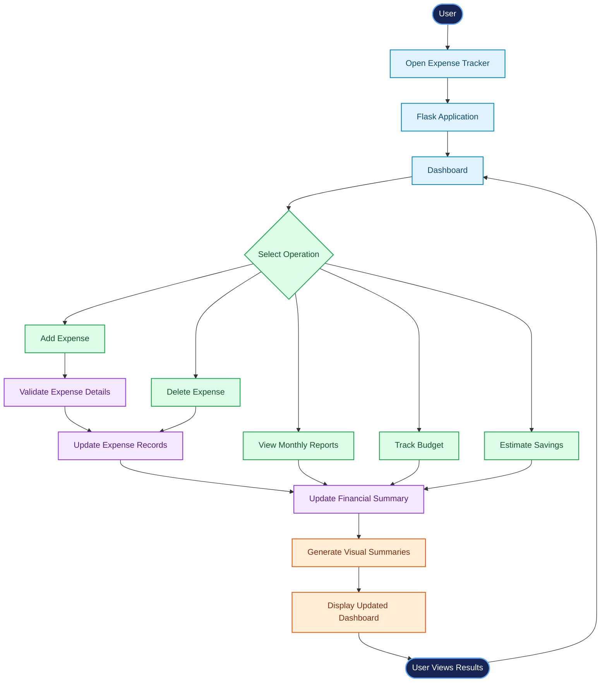

# Student Expense Tracker

### Track Your Expenses. Manage Your Budget. Build Better Saving Habits.

\<p align="center">   \   \   \   \   \ \</p>

## Overview

Student Expense Tracker is a Flask-based web application designed to help students manage their personal finances and monitor their spending habits.

The application provides a simple way to record daily expenses, track monthly expenditure, monitor budgets and estimate potential savings.

It aims to make personal financial management easier by organizing expense records and presenting useful summaries of spending patterns.

## Project Objectives

- Simplify personal expense management for students.
- Maintain records of daily expenditures.
- Monitor monthly spending patterns.
- Track budget utilization.
- Estimate potential savings.
- Present financial information in an organized and understandable format.

## Features

### 1. Expense Management

- Add new expense records.
- Delete existing expense records.
- Maintain an organized expense history.

### 2. Monthly Reports

- View monthly expenditure summaries.
- Monitor spending patterns over time.
- Understand how expenses change across months.

### 3. Budget Tracking

- Monitor expenditure against a defined budget.
- Keep track of remaining budget.
- Understand monthly budget utilization.

### 4. Savings Estimation

- Estimate potential savings based on income, budget and expenditure.
- Observe the relationship between spending and available savings.

### 5. Expense Visualization

- Present financial information through visual summaries.
- Use charts to make spending patterns easier to understand.

## Application Workflow

The following flowchart illustrates the overall working process of the application.



## Technology Stack

| Category                  | Technology              |
| ------------------------- | ----------------------- |
| Programming Language      | Python                  |
| Backend Framework         | Flask                   |
| Frontend                  | HTML                    |
| Styling                   | CSS                     |
| Client-side Functionality | JavaScript              |
| Data Visualization        | Chart.js                |
| Templating Engine         | Jinja2                  |
| Data File Included        | Excel (`expenses.xlsx`) |

## Repository Structure

```text
expense-tracker/
│
├── static/
│   ├── css/
│   ├── js/
│   └── images/
│
├── templates/
│   └── HTML templates
│
├── app.py
├── expenses.xlsx
├── .gitignore
├── README.md
│
└── Student_Expense_Tracker_Documentation.pdf
```

*The directory names shown inside `static/` and `templates/` are illustrative. Adjust them to match the actual files in your repository.*

## Installation and Setup

### 1. Clone the Repository

```bash
git clone https://github.com/ShadowCyberNinjaX/expense-tracker.git

cd expense-tracker
```

### 2. Create a Virtual Environment

```bash
python -m venv venv
```

Activate the environment:

**Linux / macOS**

```bash
source venv/bin/activate
```

**Windows**

```bash
venv\Scripts\activate
```

### 3. Install Dependencies

Install Flask and the additional packages required by the application:

```bash
pip install flask
```

If the application uses additional Python libraries, install those as well.

### 4. Run the Application

```bash
python app.py
```

Open the application in your browser at:

```text
http://127.0.0.1:5000/
```

## Screenshots

Add screenshots of the application here to demonstrate its interface and functionality.

Suggested screenshots:

| Screenshot         | Description                              |
| ------------------ | ---------------------------------------- |
| Dashboard          | Main application interface               |
| Expense Management | Adding and deleting expenses             |
| Monthly Reports    | Monthly expenditure summaries            |
| Budget Tracking    | Budget utilization and remaining balance |
| Savings Estimation | Estimated savings overview               |

Example Markdown for adding screenshots:

```markdown


```

## Future Improvements

- User authentication and individual expense profiles.
- Category-based expense filtering.
- CSV and Excel report downloads.
- More detailed monthly and yearly analytics.
- Improved budget alerts and spending notifications.
- Enhanced dashboard visualizations.
- Responsive interface for mobile devices.

## Learning Outcomes

This project provides practical experience in:

- Developing web applications using Flask.
- Connecting frontend interfaces with backend Python logic.
- Working with HTML, CSS and JavaScript.
- Using Jinja2 for dynamic page rendering.
- Managing and organizing financial records.
- Presenting data through reports and visualizations.

## Author

**Priyasha Haldar**

GitHub: [ShadowCyberNinjaX](https://github.com/ShadowCyberNinjaX)

---

**Project:** Student Expense Tracker
**Category:** Web Development / Personal Finance Management
